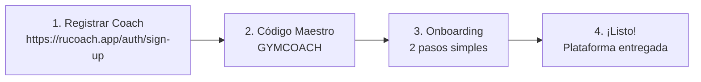

# Checklist Final: Puesta en Marcha en Producción (`rucoach.app`)

> **Todo el backend, la base de datos, el código y los correos ya están 100% listos.**  
> Lo **ÚNICO** que hace falta para el lanzamiento oficial es la activación del dominio **`rucoach.app`**.

---

## 1. Lo que YA está al 100% (Producción en Vivo)

- [x] **Dominio y DNS Oficial (`rucoach.app`):**
  - Registrado en Name.com y gestionado en Cloudflare (`elinore.ns.cloudflare.com`, `zod.ns.cloudflare.com`).
  - Registros DNS activos en modo Solo DNS (Vercel A/CNAME y Resend DKIM/SPF/MX).
- [x] **Despliegue y Certificado SSL en Vercel:**
  - `rucoach.app` y `www.rucoach.app` (redirección 307) vinculados y activos con certificado HTTPS universal.
  - Variables de entorno actualizadas en producción:
    - `NEXT_PUBLIC_APP_URL="https://rucoach.app"`
    - `EMAIL_FROM="RU Coach <noreply@rucoach.app>"`
- [x] **Dominio Verificado en Resend:**
  - Estado: **`verified`** (DKIM, SPF y Recepción de correos 100% aprobados).
- [x] **Base de Datos de Producción (Supabase `zhsreeimxiggjidgmvpo`):**
  - 22 tablas, funciones PL/pgSQL, triggers automáticos y políticas RLS activas.
  - 1,330 ejercicios bilingües con videos en Cloudflare R2 y mapeo muscular anatómico.
  - 43 logros de gamificación, rutinas y datos de clientes restaurados.
- [x] **Organización Oficial de GitHub:**
  - Repositorio transferido y sincronizado en [`rucoach-app/rucoach`](https://github.com/rucoach-app/rucoach).
- [x] **Almacenamiento Multimedia (Cloudflare R2):**
  - Bucket `gymcoaching-exercises` activo con todas las fotos y videos.

---

## 2. El Único Paso Restante: Crear la Cuenta del Coach Titular

### Paso Final: Registrar el Coach Titular
1. Entra a:  
   👉 **`https://rucoach.app/auth/sign-up`**
2. Ingresa el código maestro: **`GYMCOACH`**.
3. Registra el correo del coach (Rodrigo) y completa el onboarding de 2 pasos.
4. **¡Listo! La plataforma queda entregada «llave en mano» y operando en producción.**

