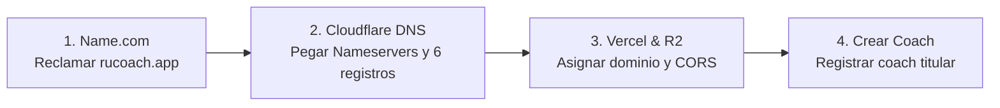

# Checklist Final: Puesta en Marcha en Producción (`rucoach.app`)

> **Todo el backend, la base de datos, el código y los correos ya están 100% listos.**  
> Lo **ÚNICO** que hace falta para el lanzamiento oficial es la activación del dominio **`rucoach.app`**.

---

## 1. Lo que YA está al 100% (No tocar nada)

- [x] **Base de Datos de Producción (Supabase `zhsreeimxiggjidgmvpo`):**
  - 22 tablas, funciones PL/pgSQL, triggers automáticos y políticas RLS activas.
  - 1,330 ejercicios bilingües con videos en Cloudflare R2 y mapeo muscular anatómico.
  - 43 logros de gamificación, rutinas y datos de clientes restaurados.
- [x] **Organización Oficial de GitHub:**
  - Repositorio transferido y sincronizado en [`rucoach-app/rucoach`](https://github.com/rucoach-app/rucoach).
- [x] **Cuenta Dedicada de Resend:**
  - Conectada a Supabase Auth por SMTP (`smtp.resend.com`).
  - Las 6 plantillas de correo HTML con diseño RU Coach e inputs OTP de 8 dígitos ya están inyectadas y activas.
- [x] **Despliegue en Vercel:**
  - Compilación sin errores (52 rutas estáticas y dinámicas).
  - Bug del creador de ejercicios resuelto (soporte multimuscular y mapa 2D).
- [x] **Almacenamiento Multimedia (Cloudflare R2):**
  - Bucket `gymcoaching-exercises` activo con todas las fotos y videos.

---

## 2. Los Únicos 4 Pasos Pendientes (Toma ~10 minutos en total)



---

### Paso 1: Reclamar el Dominio en Name.com
1. Entra a [Name.com](https://www.name.com) con tu cuenta del GitHub Student Developer Pack.
2. Registra el dominio: **`rucoach.app`**.

---

### Paso 2: Configurar DNS en Cloudflare
1. En tu panel de **Cloudflare** → haz clic en **Add a domain** → escribe **`rucoach.app`** (Plan Free).
2. Cloudflare te dará **2 Nameservers** (ejemplo: `xxx.ns.cloudflare.com`).
3. Ve a **Name.com** → selecciona `rucoach.app` → **Nameservers** → reemplázalos por los 2 de Cloudflare.
4. En **Cloudflare DNS**, agrega estos **6 registros** en modo **DNS Only (Nube Gris)**:

#### A) Para la Web (Vercel):
| Tipo | Nombre | Contenido / Destino | Proxy |
| :--- | :--- | :--- | :--- |
| **`A`** | `@` | `76.76.21.21` | **DNS Only (Gris)** |
| **`CNAME`** | `www` | `cname.vercel-dns.com` | **DNS Only (Gris)** |

#### B) Para los Correos (Resend):
| Tipo | Nombre | Valor / Contenido | Prioridad | Proxy |
| :--- | :--- | :--- | :---: | :--- |
| **`TXT`** | `resend._domainkey` | `p=MIGfMA0GCSqGSIb3DQEBAQUAA4GNADCBiQKBgQDUu4ewf/HpT3PiyZLWdf8SUXVlmuxHqvSnFBOoDkvBm6A81JKqWTDqSnj3tWmr9CmyyznUt55DDtMAYk2ZecdHmc8TAyW5Za0dQCB7DwthjMx7qq565YsR7QyWazzHQaDL7vaYwizNmVKW++rNNIYLSaXPSDMXDMAtnIUs4NWogwIDAQAB` | - | **DNS Only (Gris)** |
| **`CNAME`** | `send` | `send.forge.rmta.net` | - | **DNS Only (Gris)** |
| **`CNAME`** | `rsend` | `rsend.forge.rmta.net` | - | **DNS Only (Gris)** |
| **`MX`** | `@` | `receive.forge.rmta.net` | `10` | **DNS Only (Gris)** |

5. En tu panel de **Resend**, da clic en **Verify DNS Records** (marcará verde al instante).

---

### Paso 3: Asignar Dominio en Vercel y CORS en R2
1. **En Vercel:**
   - Ve a **Settings** → **Domains** → escribe **`rucoach.app`** y agrégalo (con redirección de `www.rucoach.app`).
   - Con Vercel CLI actualizamos las 2 variables finales:
     ```bash
     vercel env update NEXT_PUBLIC_APP_URL production --value "https://rucoach.app" --yes
     vercel env update EMAIL_FROM production --value "RU Coach <noreply@rucoach.app>" --yes
     ```
2. **En Cloudflare R2:**
   - Bucket `gymcoaching-exercises` → **Settings** → **CORS Policy** → añadir `"https://rucoach.app"` y `"https://www.rucoach.app"` a los orígenes permitidos.

---

### Paso 4: Crear la Cuenta del Coach Titular
1. Entra a:  
   👉 **`https://rucoach.app/auth/sign-up`**
2. Ingresa el código maestro: **`GYMCOACH`**.
3. Registra el correo del coach (Rodrigo) y completa el onboarding de 2 pasos.
4. **¡Listo! La plataforma queda entregada «llave en mano» y operando en producción.**

