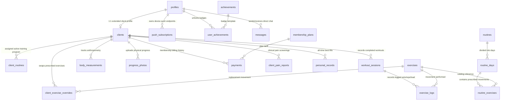

# Database Architecture & PostgreSQL Reference — RU Coach

This document details the complete relational architecture, database schema, entity relationships, stored procedures, triggers, and Row Level Security (RLS) policies powering **RU Coach** on PostgreSQL 17 via Supabase.

---

## 1. Domain-Driven Entity Map

The database is partitioned into 7 functional domains comprising **22 relational tables**:



---

## 2. Relational Schema by Domain

### Domain 1: Identity & User Profiles
1. **`public.profiles`**: Core user record synced 1:1 with `auth.users`.
   - `id` (UUID, PK, FK to `auth.users.id` ON DELETE CASCADE)
   - `email` (TEXT, NOT NULL, UNIQUE)
   - `full_name` (TEXT), `username` (TEXT, UNIQUE), `avatar_url` (TEXT)
   - `role` (ENUM: `admin`, `client`, `receptionist`)
   - `xp_points` (INT4, DEFAULT 0), `level` (INT4, DEFAULT 1), `streak_days` (INT4, DEFAULT 0)
   - `last_workout_at` (TIMESTAMPTZ), `onboarding_completed` (BOOLEAN)
2. **`public.push_subscriptions`**: Web Push (VAPID) subscription endpoints.
   - `id` (UUID, PK), `user_id` (UUID, FK to `profiles.id`)
   - `endpoint` (TEXT, UNIQUE), `p256dh` (TEXT), `auth` (TEXT)
   - `created_at` (TIMESTAMPTZ)

### Domain 2: Clinical Client Screening & Membership
3. **`public.clients`**: Athlete profile with clinical and coaching parameters.
   - `id` (UUID, PK), `user_id` (UUID, FK to `profiles.id`)
   - `coach_id` (UUID, FK to `profiles.id`)
   - `membership_start` (DATE), `membership_end` (DATE), `status` (ENUM: `active`, `suspended`, `expiring_soon`)
   - `initial_weight` (FLOAT), `current_weight` (FLOAT), `height` (FLOAT)
   - `goal` (TEXT), `experience_level` (TEXT), `notes` (TEXT)
4. **`public.client_pain_reports`**: Active injury and discomfort screening.
   - `id` (UUID, PK), `client_id` (UUID, FK to `clients.id`)
   - `body_zone` (TEXT), `severity` (INT4, 1–10), `notes` (TEXT)
   - `is_active` (BOOLEAN, DEFAULT true), `resolved_at` (TIMESTAMPTZ)
5. **`public.membership_plans`**: Master subscription tier definitions.
   - `id` (UUID, PK), `name` (TEXT), `price` (DECIMAL), `duration_days` (INT4)
   - `is_active` (BOOLEAN)
6. **`public.payments`**: Financial ledger and membership extensions.
   - `id` (UUID, PK), `client_id` (UUID, FK to `clients.id`), `plan_id` (UUID, FK to `membership_plans.id`)
   - `amount` (DECIMAL), `payment_date` (TIMESTAMPTZ), `period_start` (DATE), `period_end` (DATE)
   - `status` (ENUM: `paid`, `pending`, `failed`), `discount_percentage` (INT4)

### Domain 3: Master Exercise Catalog (1,330 Movements)
7. **`public.exercises`**: Comprehensive bilingual anatomical movement library.
   - `id` (UUID, PK)
   - `name` (TEXT, English), `name_es` (TEXT, Spanish)
   - `primary_muscle` (TEXT), `secondary_muscle` (TEXT), `target_muscles` (TEXT[])
   - `equipment` (TEXT), `equipment_es` (TEXT), `body_parts` (TEXT[])
   - `instructions` (TEXT), `instructions_es` (TEXT)
   - `gif_url` (TEXT, Cloudflare R2 endpoint), `demo_video_url` (TEXT)
   - `exercise_type` (ENUM: `strength`, `bodyweight`, `timed`, `cardio`, `mobility`)
   - `uses_external_load` (BOOLEAN, DEFAULT true)

### Domain 4: Routine Architecture & Rotation
8. **`public.routines`**: Master program templates.
   - `id` (UUID, PK), `name` (TEXT), `description` (TEXT), `coach_id` (UUID, FK to `profiles.id`)
   - `level` (TEXT), `goal` (TEXT), `duration_weeks` (INT4, NULL for continuous rotations)
9. **`public.routine_days`**: Training days within a routine cycle.
   - `id` (UUID, PK), `routine_id` (UUID, FK to `routines.id` ON DELETE CASCADE)
   - `day_number` (INT4), `day_name` (TEXT), `focus` (TEXT)
10. **`public.routine_exercises`**: Prescribed exercises per day.
    - `id` (UUID, PK), `routine_day_id` (UUID, FK to `routine_days.id` ON DELETE CASCADE)
    - `exercise_id` (UUID, FK to `exercises.id`)
    - `order_index` (INT4), `sets` (INT4), `reps` (TEXT), `rest_seconds` (INT4)
    - `warmup_sets` (INT4, DEFAULT 0), `superset_group` (TEXT, NULL or 'A'–'E'), `notes` (TEXT)
11. **`public.client_routines`**: Assignment junction between client and routine.
    - `id` (UUID, PK), `client_id` (UUID, FK to `clients.id`), `routine_id` (UUID, FK to `routines.id`)
    - `is_current` (BOOLEAN), `current_week` (INT4), `current_day_index` (INT4)
    - `override_next_day_id` (UUID, FK to `routine_days.id`, NULL for standard rotation)
12. **`public.client_exercise_overrides`**: Per-athlete movement substitutions.
    - `id` (UUID, PK), `client_id` (UUID, FK to `clients.id`)
    - `original_exercise_id` (UUID, FK to `exercises.id`), `replacement_exercise_id` (UUID, FK to `exercises.id`)
    - `routine_id` (UUID, FK to `routines.id`), `reason` (TEXT)
13. **`public.routine_week_progress`**: Weekly microcycle adherence tracker.
    - `id` (UUID, PK), `client_routine_id` (UUID, FK to `client_routines.id`), `week_number` (INT4)
    - `completed_days` (INT4[])

### Domain 5: Active Workout Engine & Biomechanics
14. **`public.workout_sessions`**: Executed training sessions.
    - `id` (UUID, PK), `client_id` (UUID, FK to `clients.id`), `routine_day_id` (UUID, FK to `routine_days.id`)
    - `started_at` (TIMESTAMPTZ), `completed_at` (TIMESTAMPTZ), `duration_seconds` (INT4)
    - `total_volume_kg` (FLOAT), `feeling_score` (INT4, 1–5), `feeling_note` (TEXT)
15. **`public.exercise_logs`**: Set-by-set execution logs.
    - `id` (UUID, PK), `workout_session_id` (UUID, FK to `workout_sessions.id` ON DELETE CASCADE)
    - `exercise_id` (UUID, FK to `exercises.id`)
    - `set_number` (INT4), `reps` (INT4), `weight_kg` (FLOAT), `rpe` (FLOAT)
    - `is_warmup` (BOOLEAN, DEFAULT false), `is_personal_record` (BOOLEAN)
16. **`public.personal_records`**: Lifetime highest calculated 1RM and top weight per exercise.
    - `id` (UUID, PK), `client_id` (UUID, FK to `clients.id`), `exercise_id` (UUID, FK to `exercises.id`)
    - `max_weight_kg` (FLOAT), `estimated_one_rep_max` (FLOAT), `achieved_at` (TIMESTAMPTZ)
17. **`public.pr_events`**: Historical record of every PR milestone broken.
    - `id` (UUID, PK), `client_id` (UUID, FK to `clients.id`), `exercise_id` (UUID, FK to `exercises.id`)
    - `previous_weight` (FLOAT), `new_weight` (FLOAT), `achieved_at` (TIMESTAMPTZ)

### Domain 6: Biometrics & Visual Body Composition
18. **`public.body_measurements`**: 7-point anthropometric logs.
    - `id` (UUID, PK), `client_id` (UUID, FK to `clients.id`), `recorded_at` (DATE)
    - `weight_kg` (FLOAT), `body_fat_percentage` (FLOAT)
    - `waist_cm` (FLOAT), `chest_cm` (FLOAT), `hips_cm` (FLOAT), `arm_cm` (FLOAT), `thigh_cm` (FLOAT)
19. **`public.progress_photos`**: Before & After photo gallery.
    - `id` (UUID, PK), `client_id` (UUID, FK to `clients.id`), `taken_at` (DATE)
    - `photo_url` (TEXT, Cloudflare R2 path), `photo_type` (ENUM: `front`, `side`, `back`)

### Domain 7: Gamification, Realtime Chat & Administration
20. **`public.achievements`**: System-defined badge templates (43 achievements).
    - `id` (UUID, PK), `code` (TEXT, UNIQUE), `name` (TEXT), `description` (TEXT), `xp_reward` (INT4)
21. **`public.user_achievements`**: Badges unlocked by athletes.
    - `id` (UUID, PK), `user_id` (UUID, FK to `profiles.id`), `achievement_id` (UUID, FK to `achievements.id`)
    - `unlocked_at` (TIMESTAMPTZ)
22. **`public.messages`**: Real-time two-way messaging between coach and athlete.
    - `id` (UUID, PK), `sender_id` (UUID, FK to `profiles.id`), `receiver_id` (UUID, FK to `profiles.id`)
    - `content` (TEXT), `is_read` (BOOLEAN, DEFAULT false), `created_at` (TIMESTAMPTZ)

---

## 3. Database Triggers & Stored Procedures

### A. Automatic Profile Provisioning (`handle_new_user`)
Fires on `AFTER INSERT ON auth.users`. Ensures every user registered via any auth method (Password, OTP, Magic Link, Invitation) automatically obtains an initialized `public.profiles` record with assigned role and default stats.
```sql
CREATE OR REPLACE FUNCTION public.handle_new_user()
RETURNS trigger AS $$
BEGIN
  INSERT INTO public.profiles (id, email, full_name, role)
  VALUES (
    NEW.id,
    NEW.email,
    COALESCE(NEW.raw_user_meta_data->>'full_name', ''),
    COALESCE(NEW.raw_user_meta_data->>'role', 'client')
  )
  ON CONFLICT (id) DO NOTHING;
  RETURN NEW;
END;
$$ LANGUAGE plpgsql SECURITY DEFINER;
```

### B. Workout Streak & Level Up Engine (`update_user_gamification`)
Automatically recalculates XP points, current level ($Level = \lfloor\sqrt{XP/100}\rfloor + 1$), and evaluates consecutive training streaks upon workout submission.

---

## 4. Row Level Security (RLS) Optimization

Every table operates with Row Level Security enabled (`ENABLE ROW LEVEL SECURITY`). 

### Performance Rule: InitPlan Optimization
To prevent PostgreSQL from re-evaluating `auth.uid()` on every scanned row (which degrades query performance from $O(1)$ to $O(N)$), all policies wrap the session function in a scalar subquery:
```sql
-- High-Performance subquery pattern (evaluated once as InitPlan):
CREATE POLICY "Clients can view own workout sessions"
  ON public.workout_sessions FOR SELECT
  USING (client_id IN (
    SELECT id FROM public.clients WHERE user_id = (SELECT auth.uid())
  ));
```

---

## 5. Migration and Seed Management

* **Master DDL Dump**: `supabase/supabase_schema_dump.sql` contains the complete idempotent database definition.
* **Seed Data**: `supabase/seed.sql` populates initial membership plans and all 43 gamification badges.
* **Exercise Migration Script**: `scripts/migrate-exercises.ts` performs idempotent UPSERTs of the 1,330 bilingual exercise definitions directly into `public.exercises`.
