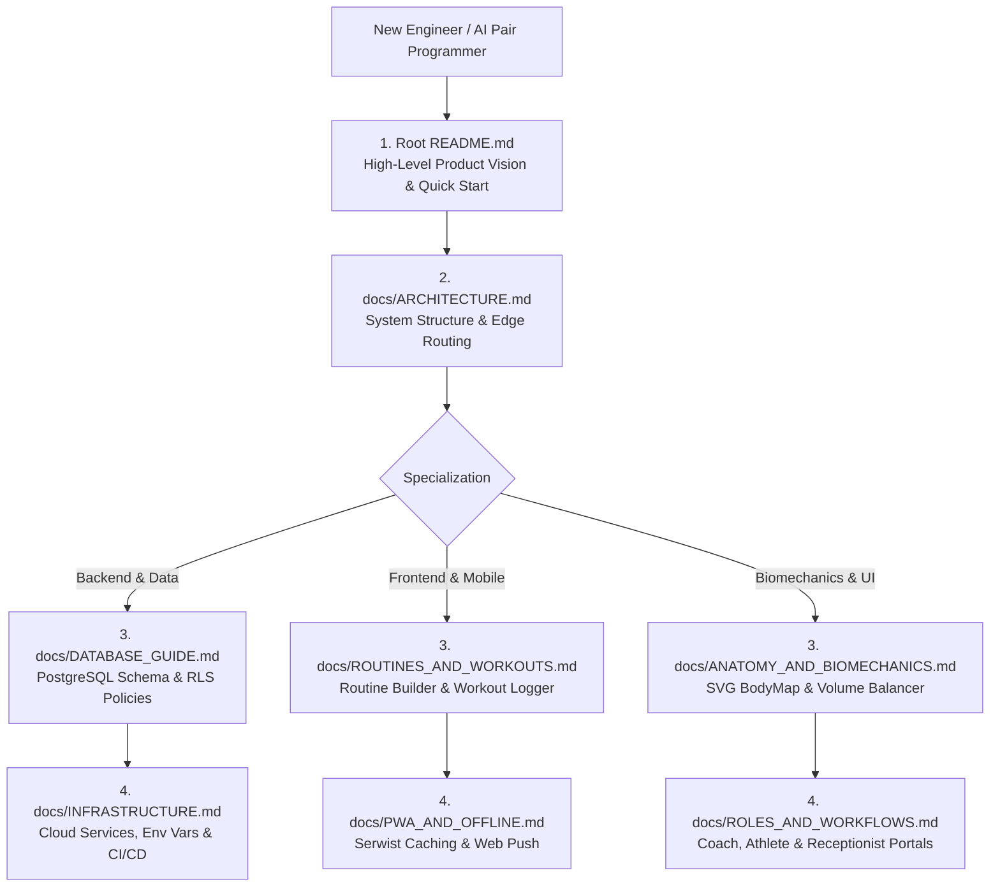

# Documentation Portal — RU Coach

Welcome to the central technical documentation portal for **RU Coach (Rodrigo Urbina Personal Coaching)**. This documentation provides a comprehensive, production-grade guide to the architecture, database schema, infrastructure, biomechanics engine, and user workflows.

---

## 1. Quick Navigation by Functional Area

| Document | Primary Focus | Target Audience |
|:---|:---|:---|
| **[`ARCHITECTURE.md`](./ARCHITECTURE.md)** | Technical stack (Next.js 16, React 19, Tailwind v4), system topology, directory structure, and edge routing. | System Architects, Full-Stack Engineers |
| **[`DATABASE_GUIDE.md`](./DATABASE_GUIDE.md)** | PostgreSQL 17 relational model (22 tables), ER diagram, triggers, stored procedures, and InitPlan-optimized RLS. | Backend Engineers, Database Admins |
| **[`INFRASTRUCTURE.md`](./INFRASTRUCTURE.md)** | Managed cloud services (Vercel, Supabase, Cloudflare R2/DNS, Resend), environment variables matrix, and CI/CD pipelines. | DevOps, Platform Engineers, SREs |
| **[`ANATOMY_AND_BIOMECHANICS.md`](./ANATOMY_AND_BIOMECHANICS.md)** | 18 canonical muscle groups, 2D SVG vector BodyMap, weekly volume balancing, neuromuscular fatigue decay, and 1RM tracking. | Sports Scientists, Biomechanics Engineers, Frontend |
| **[`ROUTINES_AND_WORKOUTS.md`](./ROUTINES_AND_WORKOUTS.md)** | Visual Routine Builder, superset/biset mechanics, live workout logger, rest timers, and clinical pain barrier auto-progression. | Product Managers, Mobile Engineers |
| **[`ROLES_AND_WORKFLOWS.md`](./ROLES_AND_WORKFLOWS.md)** | Multi-role workflows (Coach, Client, Receptionist), membership billing cycles, access suspension, and Realtime messaging. | Product Engineers, Operations |
| **[`PWA_AND_OFFLINE.md`](./PWA_AND_OFFLINE.md)** | Progressive Web App architecture, Serwist service worker caching strategies, native Web Push (VAPID), and mobile viewport handling. | Mobile Web Engineers, PWA Specialists |
| **[`archive/`](./archive/)** | Historical migration logs, initial production checklists, and legacy technical audit logs. | Historical Reference |

---

## 2. Onboarding Reading Paths

---

## 3. Core Architectural Highlights

1. **Modern Foundation**:
   Built on Next.js 16.2 with React 19 Server Components, Tailwind CSS v4, and TypeScript in strict mode.
2. **Sub-400ms Workout Boot**:
   Server actions utilize parallel database queries (`Promise.all`) to load active microcycles, historical sets, and 1RM records in a single round-trip.
3. **Local-First Crash Protection**:
   Active workout sessions are mirrored to `localStorage` on every keystroke or set completion, guaranteeing zero data loss if mobile browsers throttle background tabs.
4. **Clinical Safety Barrier**:
   Active athlete pain reports automatically lock progressive overload load increments on affected muscle groups until marked resolved by the coach.
5. **Decoupled Billing & Access**:
   Subscriptions are driven by effective calendar validity (`period_end`) with automatic routing to `/suspended` upon expiration and instant reactivation upon payment confirmation.

---

## 4. Contributing & Maintenance

When introducing changes to the codebase:
- **Database Schema**: Add idempotent migration scripts under `supabase/` and update [`DATABASE_GUIDE.md`](./DATABASE_GUIDE.md).
- **Environment Variables**: Document new variables in the matrix in [`INFRASTRUCTURE.md`](./INFRASTRUCTURE.md).
- **Documentation Integrity**: Keep documentation updated alongside code changes; avoid committing scratch checklists or personal account specifics.
