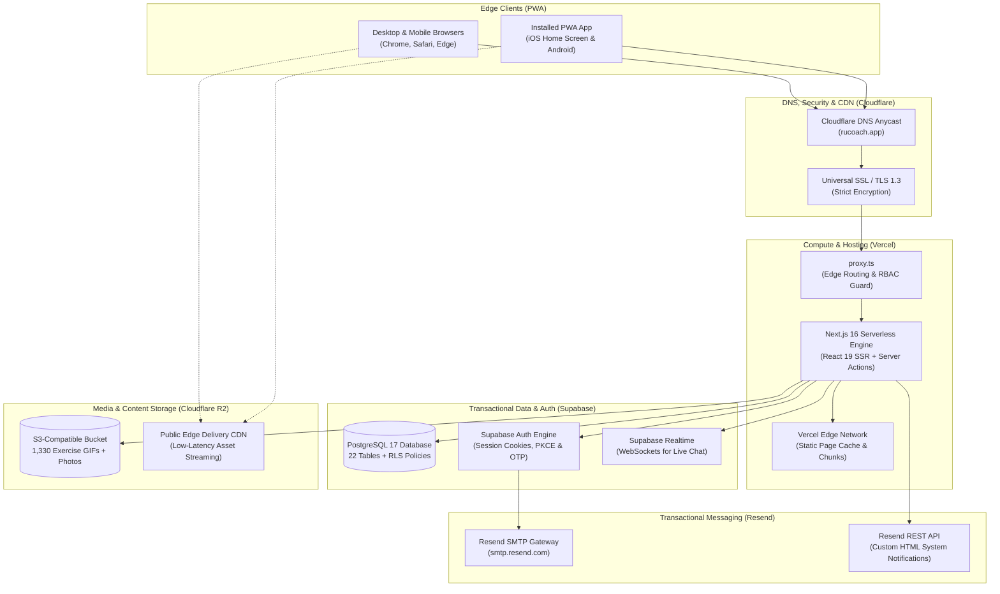
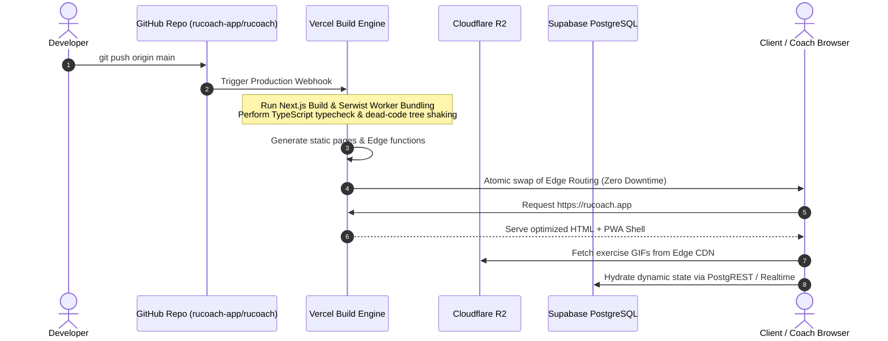

# Cloud Infrastructure and Services — RU Coach

This document provides a comprehensive, professional overview of the cloud infrastructure, hosting architecture, third-party managed services, environment configuration, and continuous deployment workflows powering **RU Coach**.

---

## 1. High-Level Infrastructure Topology

RU Coach is built upon a modern, distributed Jamstack / Serverless architecture that separates edge rendering, transactional database storage, distributed object storage, and transactional communication into dedicated, best-in-class managed services.



---

## 2. Managed Cloud Services

### A. Vercel (Edge Hosting & Serverless Execution)
* **Role**: Primary compute platform and application delivery network.
* **Why it was chosen**:
  - Native integration with **Next.js 16 App Router** and **React 19 Server Components (RSC)**.
  - Zero-cold-start edge middleware execution (`proxy.ts`) for authentication verification and Role-Based Access Control (RBAC).
  - Automatic preview deployments per branch and atomic production releases with instant rollback capabilities.
* **Configuration**:
  - Framework: Next.js (Node.js 24.x runtime).
  - Build command: `next build --webpack` (bundled with Serwist Service Worker).
  - Output directory: Default `.next`.

### B. Supabase (Database, Authentication & Realtime)
* **Role**: Core data persistence layer, identity provider, and real-time state synchronization.
* **Why it was chosen**:
  - Enterprise **PostgreSQL 17** engine with robust relational integrity, stored procedures (PL/pgSQL), triggers, and Row Level Security (RLS).
  - Native GoTrue authentication supporting secure HTTP-only cookies, PKCE redirects, password recovery, and 8-digit OTP verification.
  - Built-in WebSocket engine (`Supabase Realtime`) powering sub-millisecond coach-client messaging without external polling infrastructure.
* **Configuration**:
  - Dedicated production database instance.
  - Connection pooling enabled for serverless queries.
  - Custom SMTP integration routing transactional system emails through Resend.

### C. Cloudflare (DNS, Security & Object Storage)
* **Role**: Primary authoritative DNS provider, SSL certificate termination, and high-performance object storage.
* **Components**:
  1. **Cloudflare DNS**:
     - Fast global resolution over Anycast.
     - Dual-nameserver delegation.
     - Records configured in **DNS Only (Grey Cloud)** mode for apex domain (`@`) and `www` CNAME to allow Vercel's Edge network to directly manage SSL certs and HTTP/2 handshakes without double-proxy overhead.
  2. **Cloudflare R2 Object Storage**:
     - S3-compatible, zero-egress-fee distributed storage bucket (`gymcoaching-exercises`).
     - Houses over 1,330 exercise execution demonstrations (GIFs/MP4s), athlete progress photos, and profile avatars.
     - Public CDN distribution (`pub-*.r2.dev`) for exercise media and private signed URL access for sensitive athlete body composition photos.
     - Configured with strict Cross-Origin Resource Sharing (CORS) allowing `https://rucoach.app` and `https://www.rucoach.app`.

### D. Resend (Transactional Email Gateway)
* **Role**: Delivery of critical authentication codes, onboarding invitations, routine assignments, and payment receipts.
* **Why it was chosen**:
  - Exceptional deliverability rates with native DKIM, SPF, and DMARC alignment on custom domains.
  - Dual access via direct REST API (for server actions) and SMTP gateway (`smtp.resend.com`) for Supabase Auth system events.
  - Webhook observability and delivery event tracking.
* **Configuration**:
  - Verified domain: `rucoach.app`.
  - Authorized sender address: `RU Coach <noreply@rucoach.app>`.

---

## 3. Environment Variables Reference

Environment variables are partitioned across environments using strict separation between public runtime parameters (prefixed with `NEXT_PUBLIC_`) and private server-only secrets.

### Production & Staging Variables Matrix

| Variable Name | Exposure | Purpose / Description | Required In |
|:---|:---:|:---|:---|
| `NEXT_PUBLIC_APP_URL` | Public (Client) | Canonical public base URL (e.g. `https://rucoach.app`) used for redirects and metadata | All |
| `NEXT_PUBLIC_SUPABASE_URL` | Public (Client) | Base HTTPS URL of the Supabase project instance | All |
| `NEXT_PUBLIC_SUPABASE_ANON_KEY` | Public (Client) | Public anonymous key for client-side Supabase authentication and RLS queries | All |
| `SUPABASE_SERVICE_ROLE_KEY` | Private (Server) | Privileged administrative secret for database migrations, admin tasks, and system push operations | Server |
| `SUPABASE_ACCESS_TOKEN` | Private (Tooling) | Personal Access Token (PAT) used by developer CLI scripts to automate remote Auth configuration | Scripts / CI |
| `ADMIN_SETUP_CODE` | Private (Server) | Secret bootstrap key required to create the initial Head Coach administrator account | Server |
| `EMAIL_FROM` | Private (Server) | Standard RFC 5322 sender signature (e.g. `RU Coach <noreply@rucoach.app>`) | Server |
| `RESEND_API_KEY` | Private (Server) | API key for dispatching transactional React Email notifications via the Resend SDK | Server |
| `R2_ACCOUNT_ID` | Private (Server) | Cloudflare account identifier for the R2 S3-compatible API endpoint | Server |
| `R2_ACCESS_KEY_ID` | Private (Server) | Cloudflare S3 API Access Key ID for bucket read/write operations | Server |
| `R2_SECRET_ACCESS_KEY` | Private (Server) | Cloudflare S3 API Secret Key for cryptographic request signing | Server |
| `R2_BUCKET_NAME` | Private (Server) | Target object storage bucket name (`gymcoaching-exercises`) | Server |
| `NEXT_PUBLIC_R2_PUBLIC_URL` | Public (Client) | Public edge CDN domain serving exercise demonstration assets | All |
| `NEXT_PUBLIC_VAPID_PUBLIC_KEY` | Public (Client) | NIST P-256 public key presented to the browser to subscribe to native Web Push | All |
| `VAPID_PRIVATE_KEY` | Private (Server) | Corresponding private key used by `web-push` on the server to sign outgoing push notifications | Server |

---

## 4. Continuous Deployment and Release Pipeline



### Deployment Guidelines:
1. **Zero-Downtime Deployment**:
   Vercel deploys every commit to a unique, immutable URL. Production traffic is only routed after the build succeeds, all 50+ routes compile, and the Service Worker validates cleanly.
2. **Database Schema Migrations**:
   Schema updates are maintained as idempotent SQL migrations under `supabase/`. Schema changes must be applied before frontend releases that depend on newly introduced columns or tables.
3. **Rollback Strategy**:
   In the event of an unexpected regression, previous production deployments can be instantly restored in one click from the hosting dashboard or via CLI:
   ```bash
   vercel rollback
   ```

---

## 5. Security & Network Policies

1. **Strict Transport Security (HSTS)**:
   All HTTP traffic is forced to HTTPS with preloaded HSTS headers (`max-age=63072000; includeSubDomains; preload`).
2. **CORS (Cross-Origin Resource Sharing)**:
   Configured explicitly on Cloudflare R2 to only accept requests originating from the verified production domains:
   - `https://rucoach.app`
   - `https://www.rucoach.app`
   - Local development (`http://localhost:3000`)
3. **Database Row Level Security (RLS)**:
   Every table in the database has RLS permanently enabled. The public anonymous key cannot access or mutate records without valid JWT credentials validated against the respective athlete or coach identity.
4. **Content Security & Sandbox**:
   Avatars and user progress photos are stored in segregated storage buckets with randomized cryptographic filenames to prevent direct object enumeration attacks.
