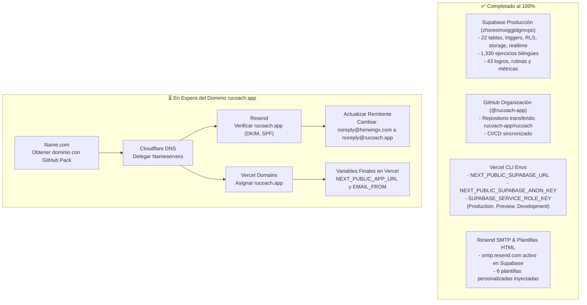

# Guía Maestra de Migración y Puesta en Marcha (`rucoach.app`)

Esta guía describe el estado actual de la migración y la lista exacta de pasos pendientes para cuando se obtenga el dominio **`rucoach.app`** en **Name.com**.

---

## 1. Estado Actual del Ecosistema



| Componente | Estado | Detalle |
| :--- | :---: | :--- |
| **Organización de GitHub** | ✅ Completado | Repositorio oficial en [`github.com/rucoach-app/rucoach`](https://github.com/rucoach-app/rucoach). |
| **Base de Datos Supabase** | ✅ Completado | Proyecto `zhsreeimxiggjidgmvpo` con schema DDL y los 1,330 ejercicios y datos restaurados. |
| **Variables Supabase en Vercel** | ✅ Completado | Actualizadas en Production, Preview y Development con Vercel CLI. |
| **Resend SMTP en Supabase** | ✅ Operativo | Configurado con `smtp.resend.com` y verificado con `noreply@herwingx.com`. |
| **Plantillas de Correo HTML** | ✅ 100% Inyectadas | Las 6 plantillas de Supabase Auth (confirmación, reseteo, OTP 8 dígitos) ya están activas. |
| **Dominio `rucoach.app`** | ⏳ Pendiente | Por adquirir en Name.com con GitHub Student Developer Pack. |
| **Cloudflare DNS** | ⏳ Pendiente | En espera de configurar Nameservers y registros A/CNAME/DKIM/SPF. |

---

## 2. Hoja de Ruta Inmediata (En cuanto tengamos el dominio)

### Paso 1: Delegación de DNS (Name.com → Cloudflare)
1. En **Cloudflare** → **Add a domain** → escribe **`rucoach.app`** → plan **Free** → **Continue**.
2. Cloudflare te asignará **2 Nameservers** (ejemplo: `ada.ns.cloudflare.com` y `bob.ns.cloudflare.com`).
3. Ve a **Name.com** → *My Domains* → selecciona **`rucoach.app`** → **Manage Nameservers**.
4. Reemplaza los servidores por los de Cloudflare y guarda cambios.

---

### Paso 2: Apuntar Dominio a Vercel
1. En **Vercel** → Proyecto `rucoach-development` (o de producción) → **Settings** → **Domains**.
2. Agrega **`rucoach.app`** (recomienda asociar `www.rucoach.app` con redirección a `rucoach.app`).
3. En **Cloudflare DNS** → agrega estos dos registros con **Nube Gris (DNS Only)**:

| Tipo | Nombre | Contenido / Destino | Proxy |
| :--- | :--- | :--- | :--- |
| **`A`** | `@` | `76.76.21.21` | **DNS Only (Gris)** |
| **`CNAME`** | `www` | `cname.vercel-dns.com` | **DNS Only (Gris)** |

> [!IMPORTANT]
> Mantén la nube en **Gris (DNS Only)** en ambos registros para evitar problemas con la emisión de certificados SSL de Vercel.

---

### Paso 3: Configurar Resend y Verificar Dominio
1. Entra a [resend.com/domains](https://resend.com/domains) → **Add Domain** → `rucoach.app` → Región: **us-east-1**.
2. Agrega los registros DNS generados por Resend (DKIM, SPF, MX) en **Cloudflare DNS** (también en **DNS Only / Gris**).
3. Presiona **Verify DNS Records** en Resend hasta que marque verde (**Verified**).
4. En **Resend API Keys** → Copia tu clave API de producción (`re_...`).

---

### Paso 4: Conectar Resend SMTP en Supabase y Aplicar Plantillas HTML
1. En **Supabase** (`zhsreeimxiggjidgmvpo`) → **Project Settings** → **Authentication** → **SMTP Settings**:
   - **Enable Custom SMTP:** Activado (ON)
   - **Sender email:** `noreply@rucoach.app`
   - **Sender name:** `RU Coach`
   - **Host:** `smtp.resend.com`
   - **Port number:** `465` (SSL) o `587` (TLS)
   - **Username:** `resend`
   - **Password:** Pega tu API Key de Resend (`re_...`)
   - Clic en **Save**.
2. Una vez guardado el SMTP, ejecuta en la terminal el script automatizado para inyectar las 6 plantillas de correo HTML:
   ```bash
   SUPABASE_ACCESS_TOKEN="sbp_TU_TOKEN_PERSONAL" npx tsx scripts/update-supabase-email-templates.ts
   ```
   *(Este script aplica automáticamente el diseño premium de Confirmación de Cuenta con OTP de 8 dígitos, Restablecer Contraseña, Magic Link, Invitación VIP, etc.)*.

---

### Paso 5: Actualizar Variables Finales en Vercel (CLI)
Con el CLI de Vercel ya enlazado, se ejecutan estos dos comandos para cambiar la URL base y el remitente de correos:
```bash
vercel env update NEXT_PUBLIC_APP_URL production --value "https://rucoach.app" --yes
vercel env update NEXT_PUBLIC_APP_URL preview --value "https://rucoach.app" --yes
vercel env update EMAIL_FROM production --value "RU Coach <noreply@rucoach.app>" --yes
vercel env update EMAIL_FROM preview --value "RU Coach <noreply@rucoach.app>" --yes
```

---

### Paso 6: Actualizar CORS en Cloudflare R2
Para que la subida de fotos y avatares funcione desde el dominio productivo sin bloqueo CORS:
1. En **Cloudflare** → **R2 Almacenamiento de objetos** → bucket **`gymcoaching-exercises`** → pestaña **Settings** → **CORS Policy**.
2. Añade `https://rucoach.app` y `https://www.rucoach.app` a los `AllowedOrigins`.

---

### Paso 7: Crear la Cuenta del Coach Titular en Producción
1. Entra a `https://rucoach.app/auth/sign-up`.
2. Ingresa el código maestro de administrador configurado en `ADMIN_SETUP_CODE` (`GYMCOACH`).
3. Registra el correo oficial del coach y completa el onboarding de 2 pasos.
4. ¡Listo! La plataforma queda 100% operativa y lista para recibir clientes.
