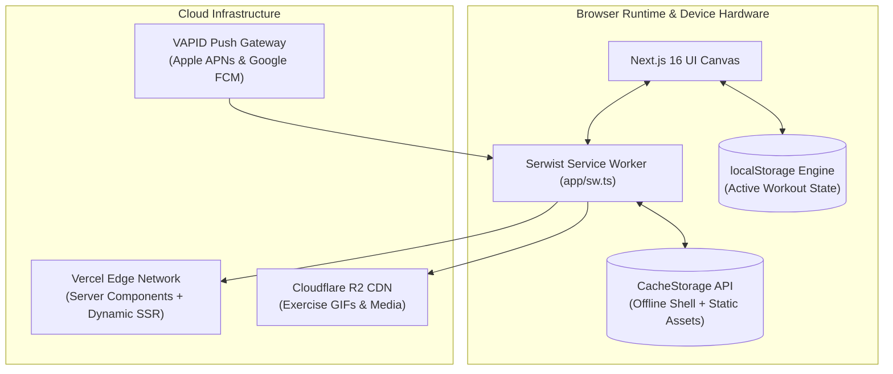
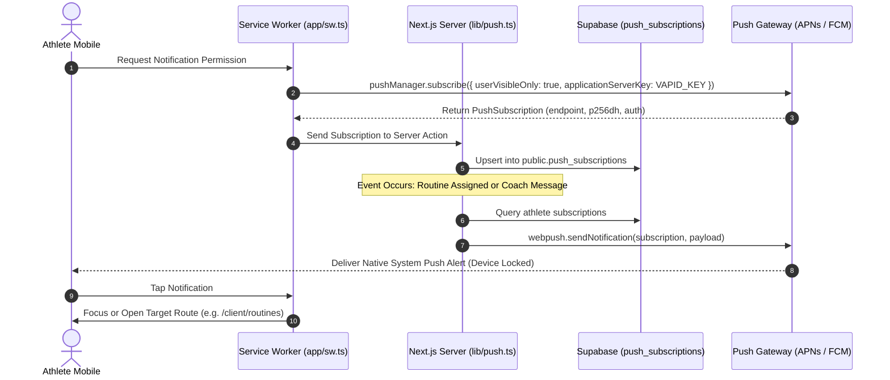

# Progressive Web App (PWA) & Offline Architecture — RU Coach

This document details the progressive web application (PWA) architecture, service worker caching strategies, background synchronization, and native Web Push notification systems implemented in **RU Coach**.

---

## 1. PWA Architectural Overview

RU Coach is architected as an **Installable Progressive Web App** delivering a native mobile app experience on iOS (Safari/WebKit) and Android (Chrome/Blink) without requiring app store distribution:



---

## 2. Service Worker Engine (`app/sw.ts` with Serwist)

RU Coach utilizes **Serwist** (the modern, high-performance successor to Workbox tailored for Next.js App Router and Webpack):

### Caching Strategy Tiers:

1. **Precached App Shell (`precacheAndRoute`)**:
   - Critical JavaScript chunks, CSS stylesheets, web manifest (`/manifest.webmanifest`), and application icons (`/android-chrome-192x192.png`, etc.) are pre-cached upon service worker installation for instant cold boot.
2. **Exercise Demonstrations & Media (`StaleWhileRevalidate`)**:
   - Requests to Cloudflare R2 (`https://pub-*.r2.dev/exercises/*`) are cached locally with an expiration limit of 180 days and a maximum capacity of 500 cached entries. If the user repeats an exercise, the demonstration loads instantly from local device storage without consuming cellular data.
3. **Google Fonts & Typography (`CacheFirst`)**:
   - Web font files (`.woff2`) are cached with a 1-year expiration policy.
4. **Dynamic Data & Workout APIs (`NetworkFirst`)**:
   - Training session updates and coaching notes prioritize real-time server responses. If the device experiences total connection loss in an underground gym, the service worker serves the latest cached snapshot and prevents error screens.

---

## 3. Web Push Notifications (VAPID Architecture)

RU Coach incorporates native, background Web Push notifications compliant with the W3C Push API and RFC 8292 (VAPID):



### Self-Cleaning Subscription Pipeline:
Mobile devices periodically revoke or rotate push tokens (e.g. browser reset or app uninstalled). When `lib/push.ts` dispatches a notification:
- If the push gateway responds with `404 Not Found` or `410 Gone`, the server action **automatically deletes the dead endpoint from `public.push_subscriptions`**, keeping the database lean and maintaining a 100% healthy delivery pool.

---

## 4. Mobile UX & Native Hardware Integration

### A. Virtual Keyboard Compensation (`window.visualViewport`)
On iOS Safari, opening the software keyboard resizes the visual viewport rather than the layout viewport, often causing fixed action bars and chat inputs to become trapped beneath the keyboard. RU Coach implements a dynamic height subscriber:
```typescript
window.visualViewport.addEventListener("resize", () => {
  const keyboardHeight = window.innerHeight - window.visualViewport.height;
  container.style.paddingBottom = `${keyboardHeight}px`;
});
```

### B. Safe Area Insets (Notch & Home Bar Protection)
Every layout shell in RU Coach adheres to CSS environment variables:
```css
/* Header sticky alignment */
padding-top: env(safe-area-inset-top);

/* Bottom tab navigation & Floating rest timer */
padding-bottom: max(1rem, env(safe-area-inset-bottom));
```

### C. Haptic Feedback & Audio Synthesis
During workouts, set completion and rest timer expiration trigger hardware vibration via `navigator.vibrate([100, 50, 100])` paired with dual-frequency synthesized sine waves generated via the browser's `AudioContext`, ensuring athletes hear and feel alerts over loud gym music.
