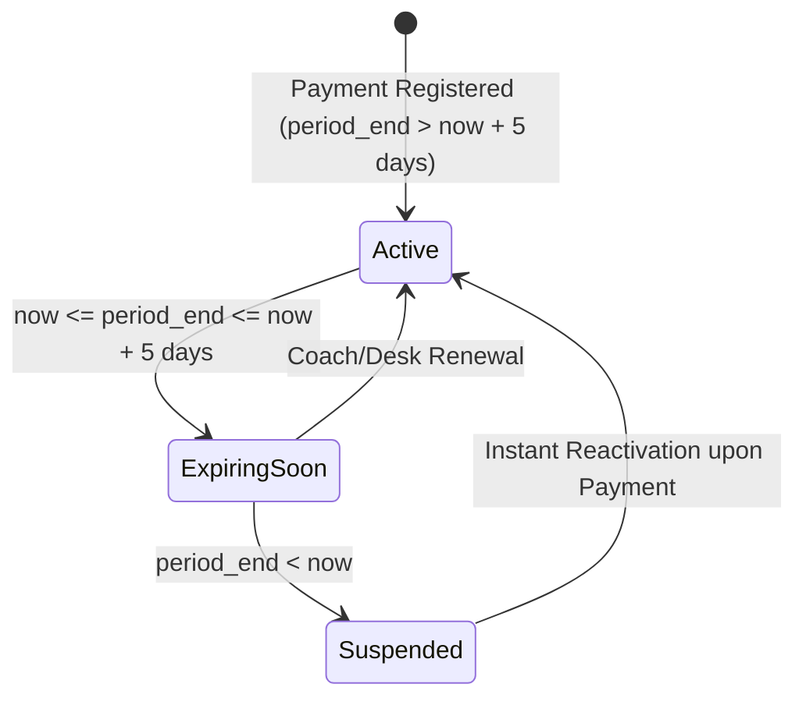
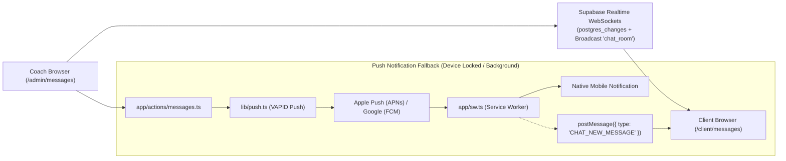

# Roles, Workflows & Ecosystem Guide — RU Coach

This document details the multi-role architecture, user permission boundaries, membership billing lifecycles, and real-time communication systems implemented in **RU Coach**.

---

## 1. Role-Based Access Control (RBAC) Matrix

RU Coach enforces strict role-based route protection at the Edge via `proxy.ts`:

| Route Prefix | Permitted Roles | Purpose | Unauthenticated Behavior |
|:---|:---:|:---|:---|
| `/admin/*` | `admin` | Head Coach control center, athlete hub, routine designer, catalog, billing | Redirects to `/auth/login` |
| `/client/*` | `client` | Athlete training portal, live workout logger, progress tracking, chat | Redirects to `/auth/login` |
| `/receptionist/*` | `receptionist`, `admin` | Front desk athlete check-in, attendance scanner, fast manual payment reception | Redirects to `/auth/login` |
| `/onboarding` | `client` | 4-step athlete intake screening (goals, availability, biometric baseline, injuries) | Redirects to `/auth/login` |
| `/suspended` | `client` (with expired membership) | Friendly lock screen advising athlete to coordinate renewal with coach | Accessible only if active session |

---

## 2. Portal Workflows by User Role

### A. Coach & Administrator Portal (`/admin/*`)
1. **Operational Dashboard (`/admin/dashboard`)**:
   - High-level KPIs: Active athletes, completed workouts this week, new PRs broken this month, and pending clinical reports.
   - Inactivity alerts: Automatic flagging of athletes with $\ge 3$ days without logging a session.
   - Membership expiry warnings: Alerts for athletes whose subscription expires within $\le 5$ days.
2. **Athlete 360° Profile Hub (`/admin/clients/[clientId]`)**:
   - **Clinical Injury Banner**: Displays active pain reports (`client_pain_reports`) with severity score ($1–10$), body region, and one-click resolution button (`resolveClientPainReport`).
   - **Routine Tab**: Real-time weekly muscle coverage map, list of athlete exercise overrides with one-click restore (`revertExerciseOverride`), and program assignment modal (`AssignRoutineModal`).
   - **History Tab**: Detailed workout log cards displaying total tonnage, session duration, and the athlete's post-workout feeling score ($1–5$).
   - **Progress & Biometrics Tab**: SVG BodyMap volume balance, 52-week activity heatmap, 1RM strength curves, 7-point anthropometry charts, and R2-signed progress photos.
3. **Routine Designer (`/admin/routines/builder`)**:
   - Visual drag-and-drop constructor with superset grouping (`A`–`E`), warmup sets configuration, and live anatomical coverage calculation.
4. **Exercise Catalog (`/admin/exercises`)**:
   - Interactive 2D anatomical body map filtering, bilingual search (`_es` primary), and step-by-step numbered instruction editor (`ExerciseFormModal`).
5. **Membership Billing & Plans (`/admin/payments` & `/admin/settings`)**:
   - Master plan management (`membership_plans`), one-click renewals, fast discount pills (`-10%`, `-15%`, `-20%`, `-50%`), and custom amount billing.

---

### B. Client & Athlete Portal (`/client/*`)
1. **Athlete Dashboard (`/client/dashboard`)**:
   - **Next Session Card (`NextWorkoutCard`)**: Next prescribed workout in the continuous rotation cycle with direct **"Comenzar Entrenamiento"** and **"Cambiar día"** actions.
   - Weekly workout target tracker ($X / Y$ sessions completed).
   - Streak counter, current level, XP progress bar, and volume statistics.
2. **Routine Overview (`/client/routines`)**:
   - Horizontal compact cards showing exercise GIFs, prescribed sets/reps, and pedagogical volume proportion breakdown.
3. **Live Workout Logger (`/client/workout/start`)**:
   - Zero-latency startup, minimizable rest timer, warm-up vs working set separation, and crash-resilient `localStorage` caching.
4. **Physical Progress & Measurements (`/client/progress`, `/client/measurements`, `/client/photos`)**:
   - 7-point anthropometric tracker (weight, body fat %, waist, hip, chest, arm, thigh).
   - Side-by-side Before/After photo comparison slider with signed URLs from Cloudflare R2.
5. **Gamification & Trophies (`/client/achievements`)**:
   - Interactive trophy cabinet displaying unlocked and locked achievements with XP reward values.

---

### C. Receptionist Portal (`/receptionist/*`)
1. **Express Check-In (`/receptionist/check-in`)**:
   - Fast athlete lookup by name or email.
   - Instant membership status badge: **Active (Green)**, **Expiring Soon (Amber)**, or **Expired (Red)**.
   - One-tap check-in logging athlete gym entry without granting access to sensitive clinical coaching notes.
2. **Desk Payments (`/receptionist/payments`)**:
   - Quick receipt issuance for cash or card payments at reception with automatic access renewal.

---

## 3. Membership Lifecycle & Suspension Engine

RU Coach decouples billing receipt generation from effective membership validity:

### Automatic Access Synchronization:
1. **Grace Period Warnings**:
   When an athlete's `membership_end` reaches $\le 5$ days from the current date, an ambient amber banner is surfaced on their mobile dashboard with an action link to contact their coach.
2. **Suspension Routing**:
   If an athlete attempts to access `/client/*` after `membership_end` has passed, the layout guard automatically routes them to `/suspended`.
3. **Instant Reactivation**:
   As soon as a payment is marked as `paid` in `/admin/payments`, the server action updates `clients.membership_end` and `clients.status = 'active'`, allowing the athlete to immediately resume training upon page refresh.

---

## 4. Real-Time Communication Architecture

RU Coach incorporates a dual-channel real-time messaging pipeline linking coaches and athletes:

### Key Technical Innovations:
* **iOS / Android Virtual Keyboard Handling (`VisualViewport`)**:
  In `components/chat/chat-view.tsx`, the message list dynamically binds to `window.visualViewport.height`. When the mobile virtual keyboard slides open, the input container remains pinned above the keyboard without pushing the header offscreen or clipping earlier messages.
* **Service Worker Bridge**:
  If the application is in the background or minimized, incoming messages trigger a native VAPID Web Push notification. When the user taps the notification, the Service Worker executes a `postMessage` event to hydrate the chat store before the tab even renders.
