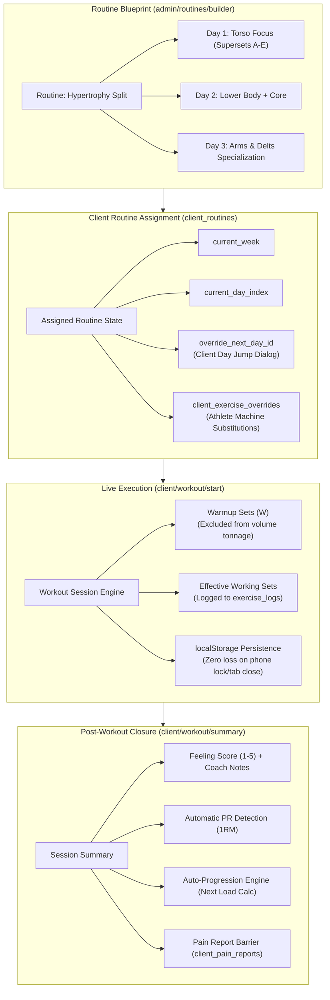

# Routines, Live Workout Engine & Auto-Progression — RU Coach

This document details the complete training lifecycle in **RU Coach**: from program creation in the visual Routine Builder to live set-by-set execution in the gym and the automated progressive overload engine.

---

## 1. Routine Architecture & Rotation Mechanics

RU Coach supports both **Continuous Rotation Programs** and **Fixed-Period Microcycles**.

---

## 2. Visual Routine Builder (`/admin/routines/builder`)

The Routine Builder provides an interactive canvas for coaches:
1. **Continuous Multi-Week Rotations**:
   By setting `duration_weeks = null`, the program advances seamlessly session-by-session without forcing rigid calendar day constraints (preventing missed days from disrupting the stimulus balance).
2. **Supersets & Biseries (Groups A–E)**:
   Exercises can be paired into antagonistic or agonist superset blocks by tagging them with a `superset_group` identifier (`A`, `B`, `C`, `D`, `E`). The mobile athlete view renders paired exercises in interconnected visual container cards.
3. **Warmup / Feeder Sets (`warmup_sets`)**:
   Coaches can specify how many preparatory warm-up sets precede the working sets. These are clearly marked with a `(W)` badge during live execution and are automatically excluded from the calculated total volume tonnage to maintain scientific accuracy.
4. **Non-Destructive Updates (`updateRoutineFromBuilder`)**:
   When a coach edits a routine in production, the server action matches existing `routine_days.id` records rather than executing a destructive `DELETE + INSERT`. This guarantees that:
   - Athlete exercise substitutions (`client_exercise_overrides`) remain intact.
   - Ongoing active sessions are not invalidated mid-workout.

---

## 3. Athlete Exercise Overrides (`client_exercise_overrides`)

When an athlete encounters a occupied gym machine or biomechanical constraint, RU Coach allows on-the-fly exercise substitution:
1. The athlete taps **"Cambiar Ejercicio"** on their mobile interface.
2. The system filters the 1,330-exercise catalog to recommend alternatives targeting the exact same primary muscle group and equipment class.
3. Upon selection, an override record is created in `public.client_exercise_overrides`.
4. The coach is notified in their administrative portal (`/admin/clients/[clientId]`) under the *Rutina* tab, where they can review the athlete's reason or click **"Restaurar original"** with one tap.

---

## 4. Live Workout Session Engine (`/client/workout/start`)

The live training interface is engineered for real-world gym conditions where network connectivity is intermittent and phone screens frequently lock:

* **Sub-400ms Parallel Startup**:
  The server loads the active routine day, previous workout history for every exercise, personal records, and active pain screening reports concurrently using `Promise.all`.
* **Local-First Crash Protection**:
  Every logged rep, weight adjustment, and checkbox toggle is immediately mirrored to browser `localStorage`. If the browser tab crashes or the operating system terminates the browser to save memory, the session resumes instantly upon reopening.
* **Minimizable Floating Rest Timer**:
  When a set is completed, a rest countdown timer automatically begins. The timer modal can be minimized to a floating bottom bar (`⏱ Descanso activo: 1:30 | +30s | Saltar`), allowing the athlete to inspect technique notes or exercise demonstration GIFs while resting.
* **Vibration & Haptic Audio Feedback**:
  The Web Audio API and Native Vibration API alert the athlete with a 3-second countdown tone and double vibration pulse when rest time expires.

---

## 5. Post-Workout Summary & RPE Logging (`/client/workout/summary`)

Upon tapping **"Finalizar Entrenamiento"**, the athlete completes a mandatory post-session assessment:
1. **Metrics Review**: Total working volume moved (in metric tons), duration in minutes, and exercises completed.
2. **Effort & Feeling Score (`feeling_score` 1–5)**:
   - `1`: Exhausted / Pain / Extreme fatigue (Triggers an administrative review flag).
   - `2`: Very heavy / Near failure.
   - `3`: Balanced / Optimal workout.
   - `4`: Great energy / Solid progression.
   - `5`: Incredible session / Felt effortless.
3. **Athlete Feedback Note (`feeling_note`)**: Direct contextual feedback sent to the coach.

---

## 6. The Automatic Progression Engine (`lib/auto-progression.ts`)

RU Coach incorporates an evidence-based progressive overload calculation that recommends target loads for the athlete's subsequent workout:

### Decision Rules:
1. **Target Rep Range Completion**:
   If the athlete achieves the upper rep limit across all prescribed working sets with an RPE $\le 8.5$, the engine calculates a load increment:
   $$\Delta W = \begin{cases} 
   +2.5\text{ kg} & \text{for Upper Body movements} \\ 
   +5.0\text{ kg} & \text{for Lower Body compound movements} 
   \end{cases}$$
2. **Clinical Safety Barrier (`client_pain_reports`)**:
   If the athlete has an active unresolved pain report in `public.client_pain_reports` affecting the anatomical muscle group utilized by an exercise, the auto-progression algorithm is **automatically locked**:
   - The platform will NOT suggest load increases.
   - A clinical notice banner is displayed advising deload or movement substitution until the coach marks the pain report as resolved.
